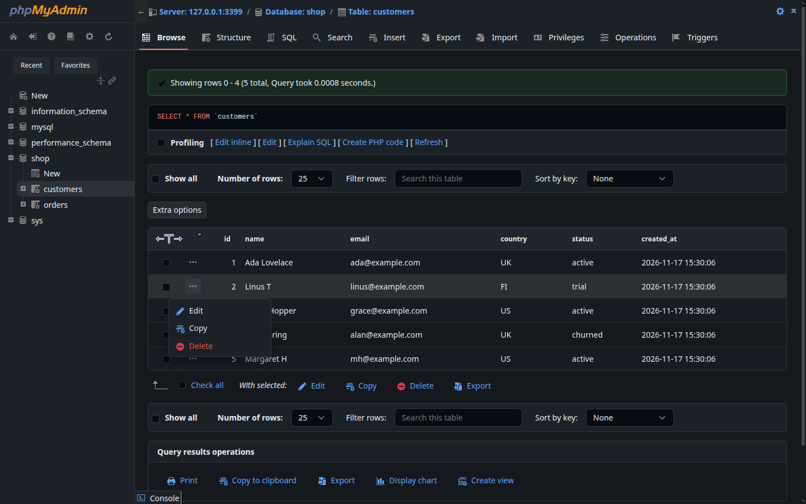

<div align="center">

# GitDark

**A GitHub-style dark theme for phpMyAdmin 5.2**


</div>



GitDark gives phpMyAdmin the calm, dense look of a modern code-hosting dashboard: a cool dark palette, a system font stack, bordered boxes with header bars, and one accent per job. Orange marks where you are, green marks the primary action, and blue is reserved for links.

## Features

- **Primer-inspired palette** with a neutral chrome. Icons in the tab bar, breadcrumb and sidebar are muted so links and actions stand out.
- **Underline tab navigation** with an orange active indicator, and quiet secondary pills.
- **Boxes and tables** with 6px radii, prominent header bars with a bottom rule, tabular numbers, and tables that span the full content width.
- **Row actions menu.** On Browse results, Edit, Copy and Delete collapse into a "⋯" menu that opens on hover or keyboard focus. It is CSS only: phpMyAdmin's templates and scripts are untouched, so the delete confirmation and inline cell editing keep working.
- **Click-anywhere row selection** on the table list under *Database → Structure*. The checkboxes are hidden and the whole row is the target, and *Check all* still works.
- **Aligned layout.** The sidebar header and the top bar share their dividers, and spacing follows a consistent 4/8 px-based rhythm.
- **GitHub-dark syntax colors** in the SQL editor, plus restyled dialogs, menus and date picker (jQuery UI).

## Installation

Clone the repository into phpMyAdmin's `themes` directory. The folder must be named `gitdark`.

```bash
cd /path/to/phpmyadmin/themes
git clone https://github.com/faizansf/gitdark.git gitdark
```

Then select the theme under **Home → Appearance settings → Theme**, or make it the default in `config.inc.php`:

```php
$cfg['ThemeDefault'] = 'gitdark';
```

The compiled stylesheets are included, so no build step is needed to use the theme.

## Compatibility

| | |
| --- | --- |
| phpMyAdmin | 5.2.x |
| Browsers | Current Chrome, Edge, Firefox 121+, Safari 15.4+ |

The row actions menu and row selection use the CSS `:has()` selector. Older browsers ignore those rules and show phpMyAdmin's standard action links and checkboxes instead.

The row actions menu applies to the default "left" action layout when Edit, Copy and Delete are all available. In other layouts the standard links are shown.

## Building from source

`scss/` imports Bootstrap 5.3 from phpMyAdmin's `node_modules`, so build from inside a phpMyAdmin source checkout (run `yarn install` there first):

```bash
# from the phpMyAdmin root
npx sass --no-source-map --style=compressed themes/gitdark/scss/theme.scss themes/gitdark/css/theme.css
npx postcss themes/gitdark/css/theme.css --use autoprefixer --replace --no-map
npx rtlcss themes/gitdark/css/theme.css   # writes css/theme.rtl.css
```

| File | Purpose |
| --- | --- |
| `scss/_variables.scss` | Palette, typography and Bootstrap variable overrides |
| `scss/_github.scss` | The GitHub-style component layer, imported last |
| `jquery/jquery-ui.css` | jQuery UI skin |

## Credits and license

GitDark is derived from [BooDark](https://github.com/adorade/boodark) by adorade and from the themes bundled with [phpMyAdmin](https://www.phpmyadmin.net/). It is released under the [GNU General Public License v2.0](LICENSE), the same license as phpMyAdmin.
